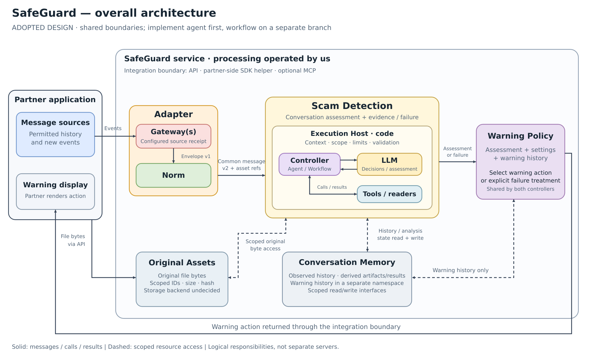
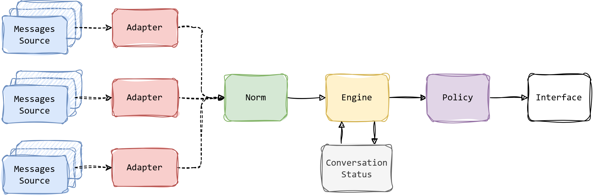
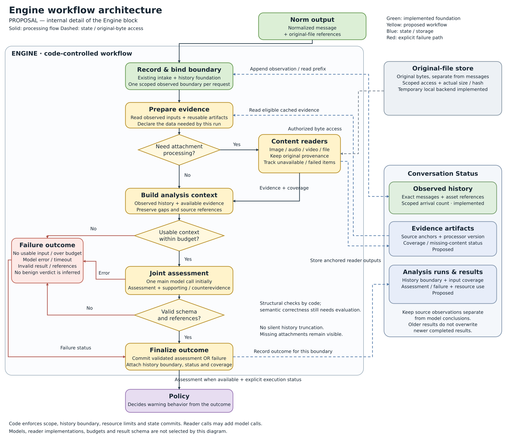

<div align="center">

# mini-safeguard


**Research conversation scam detection with interchangeable agent and workflow control.**

</div>

---

## Scope

Observe a conversation as messages arrive, assess scam risk in Scam Detection, and let separate
Warning Policy decide whether and when to warn. The engine research will compare workflow and agent
control; neither has demonstrated superiority in this rebuild. Development now starts with the
agent; the workflow alternative will be implemented on another branch.

---

## Architecture

The following logical architecture was **adopted on November 11, 2026**. It preserves the closed
Adapter composition and separates domain assessment, execution control, models/tools, state and
warning decisions. Component roles are adopted; implementation remains partial. Source packages
now use the adopted component names.



[Editable SVG](docs/assets/system-architecture-proposal.svg) ·
[Agent/workflow controller comparison](docs/assets/controller-architectures-proposal.png) ·
[Editable comparison SVG](docs/assets/controller-architectures-proposal.svg)

The **Scam Detection** block returns a conversation assessment/evidence or explicit
failure. Its **Execution Host** provides admission/context, permission/resource enforcement and
result validation. Its **Controller** determines the next operation: model-directed in the agent
variant, code-directed in the workflow variant. Both use the same model/tool access contracts.
**Warning Policy** chooses user-facing actions and owns warning-history updates. **Conversation
Memory** keeps observed and derived state distinct; **Original Assets** holds source bytes behind
scoped retrieval. Original uploads use integration/file-ingress coordination, separate from
Adapter.receive(). The partner application supplies permitted input and renders returned actions.

These are logical responsibilities, not mandatory separate servers. Real model/readers, complete
controllers, derived-state commits, Warning Policy and production integration remain unimplemented.
Code lives in safeguard.scam_detection, conversation_memory, original_assets and adapters;
existing serialized contracts remain unchanged.

The internal LLM call contract is specified at the design level: trusted context/tool binding,
tool proposals, structured results, unavailable/refusal responses, operational failures and usage.
Neutral offline examples check its mapping to the current Host. The model client, provider-specific
validation and actual controller loop remain unimplemented; these checks do not measure model quality.

<details>
<summary>Earlier owner-supplied sketch, preserved as reference</summary>



</details>

Adapter is the containing input block: Gateway handles source receipt and Norm converts its
native events into common internal messages. The supplied image is preserved; the table states
this component grouping. Scam Detection and separate Warning Policy are adopted logical boundaries.

| Part | Responsibility in the current design |
|---|---|
| Adapter | Combine Gateway and Norm and return the common internal message |
| Gateway, inside Adapter | Receive source events and preserve source context and native payload |
| Norm, inside Adapter | Interpret native data using its source mapping and produce the common internal message |
| Scam Detection | Assess the observed conversation and return evidence/coverage or explicit failure; composed from host, controller, models and tools |
| Warning policy | Decide whether/when to warn from the assessment and permitted warning history |
| Interface | Present the policy's action to the user |
| Conversation Memory | Separate observed history, derived artifacts/results and warning history; concrete state APIs/persistence remain incomplete |
| Original Assets | Store original bytes separately from messages and derived evidence; scoped retrieval uses source identities and size/hash |

Two input representations must stay distinct:

- **Gateway envelope (version 1.0):** internal Adapter handoff metadata plus `payload`, the original source event data.
  A common wrapper does not make the source's content a common internal message.
- **Internal message:** the provisional source-independent record produced by the one-message
  demo normalizer. It is integrated with deterministic Engine intake below; the analysis contract remains provisional.

The [current handoff schema](src/safeguard/adapters/contract.schema.json) preserves native payloads. Adding a
source therefore requires a Gateway **and** a compatible Norm mapping inside Adapter.
The purpose is to keep platform field names out of the engine. Engine analysis and user-facing
warning decisions remain separate. Concrete assessment fields, warning rules and production
state/integration details remain unselected; adoption does not imply that the service is implemented.

---

## Current implementation

Application code lives under `src/safeguard/`, with `adapters/gateways`, `adapters/norm`,
`scam_detection`, `conversation_memory` and `original_assets` matching the implemented components.
`scam_detection/execution_host.py` supplies the shared Host; `scam_detection/tools/evidence.py`
supplies the reader/evidence boundary. ControllerSpec/ControllerReply declare the controller slot;
actual agent/workflow controllers and model clients remain unimplemented. No empty packages imply
that those missing components are complete. Component tests and their neutral fixtures live under `tests/`;
architecture illustrations live under `docs/assets/`. Active audit tools live under
`src/safeguard/evaluation/`; evaluation evidence and outputs stay under `evaluation/`.
The `src` directory is placed on the import path by the test command below. No package installation
is needed for that command. Package metadata and schema-resource inclusion are in `pyproject.toml`.

The rebuild starts with small, separately checked components. The deterministic
[Engine intake](src/safeguard/scam_detection/intake.py) now connects normalized arrivals to
[in-memory observed history](src/safeguard/conversation_memory/in_memory.py) and a substitute analyzer.
It reuses the [observed-history boundary](src/safeguard/conversation_memory/history.py) to select detached prefixes.
The [context preparer](src/safeguard/scam_detection/context.py) projects those prefixes into bounded,
immutable analysis-input documents with positional source references and unprocessed attachment coverage.
No workflow/agent fraud assessment or model invocation is implemented.

The enclosing [Adapter](src/safeguard/adapters/core.py) composes an explicitly supplied Gateway
factory and synchronous Norm. The [demo composition](src/safeguard/adapters/demo.py),
`create_demo_adapter(clock=...)`, connects DemoGateway with the demo Norm. Adapter returns a
validated, detached common message; fixed `AdapterError(stage, code)` diagnostics distinguish
Gateway, Norm and receiver-contract failures. Its ordered stream APIs deliver normalized messages.
The coordinator requires an injected Adapter and does not select a source from payload claims.

The [DemoGateway](src/safeguard/adapters/gateways/demo.py) receives an already decoded demo-native
object and explicit account context. It constructs a detached native-payload envelope. Its
`conversation_id(native)` inspection supplies routing identity before receipt/copying, so the
coordinator can check permission and capacity without reading demo field names.
The native-envelope schema and contract checker remain unchanged. Real source transport,
partner authentication, the full engine, warning policy and interface integration are absent.

DemoGateway requires `thread`, `id`, `author` (nonblank strings), plus either legacy `body`
(nonempty text) or ordered `content_parts`. Supplying both is rejected. Parts support `text`,
`image`, `audio`, `video` and `file`; attachment-only messages need no text. Asset parts refer
to entries in the message's `assets` catalog. Other JSON fields remain opaque in the payload.
The Gateway's clock returns a timezone-aware datetime; observation time is represented in UTC
and never substituted for missing native send time. The implementation uses the standard library.

`DemoGateway.receive_stream(events)` consumes a synchronous iterable of decoded native events
one requested item at a time, using the same single-event checks. It preserves supplied order,
payloads and conversation identities, without sorting or deduplication. An empty stream produces
no envelopes. Invalid events or observation-clock failures terminate the iterator; earlier outputs
remain available and later events stay unread. Errors advancing the source propagate. The caller
owns source resources. This verifies local iterator behavior, not a real messaging connection or
delivery to the normalizer.

`DemoGateway.deliver_stream(events, receiver)` connects that stream to a supplied synchronous
receiver, completing one callback before reading the next native event. The callback accepts
the unchanged envelope and returns `None`, or raises on rejection/failure. A different return
value is an explicit receiver-contract error. Full success returns the completed callback count.
Errors stop delivery without skip, retry or rollback; a failing callback may already have
performed an effect. Tests use a schema-checking recorder, not a real normalizer. This establishes
local handoff behavior; it does not establish durable delivery or successful normalization.

The [one-message normalizer](src/safeguard/adapters/norm/core.py) implements the provisionally accepted
demo profile. `normalize(adapter_event)` validates the existing v1.0 envelope, reconciles native
and envelope IDs, and returns a typed version-`2.0` `NormalizedMessage` dictionary. It preserves exact text,
scoped IDs, observation time and a detached complete `raw_payload`. The sender flag compares
sender/account IDs only. Missing/null native send time stays null; supported explicit source times
convert to UTC without dropping fractional digits. Malformed or unsupported inputs raise a fixed
`NormalizationError(field, code)` with no partial output or echoed private value. Runtime uses the
standard library, with no IO, clock read, history or model. Adapter invokes Norm per message, validates the common output and checks that source, account,
conversation, message identity and native provenance remain consistent. ConversationIngress uses
the Adapter result and applies common content limits before file/history admission. Production
source support still requires its own mapping and integration checks; Engine history/context
remain demo-profile scoped.

The composition increment passes 281 tests/788 subcases using neutral inputs, including a
second test-only Gateway/Norm pair with different native fields and existing history/file/host
integration. This is not a second real platform integration. A fixed-clock CPU probe compared
48 runs/2,706 message occurrences with the pre-change implementation: all logical output hashes
match. Added boundary validation/copying increases measured adaptation time by 2.41–5.00 times
in this small matrix with allocation tracing enabled; this is not end-to-end service latency.
No model or benchmark data was used.

The [content types](src/safeguard/messages.py) distinguish ordered `content_parts` from original
asset descriptors. Legacy `body` becomes one text part; there is no flattened top-level `text`
in version 2.0. The adapter envelope remains version 1.0. A native attachment-only example:

```json
{
  "thread": "toy-room", "id": "toy-note", "author": "toy-reader",
  "content_parts": [{"kind": "file", "asset_id": "toy-document"}],
  "assets": [{"asset_id": "toy-document", "filename": "reading-list.txt",
              "declared_media_type": "text/plain", "declared_size_bytes": 12,
              "source_status": "pending"}]
}
```

Asset IDs are opaque and scoped to the enclosing source/account/conversation/message. Descriptor
order and content-part order are preserved. Missing metadata becomes null; missing source status
becomes `unknown`. Source status may also be `available`, `pending`, `unavailable` or `failed`;
these are unverified source reports. Normalized descriptors always have
`processing_status="not_requested"`. MIME, size and filename are source declarations. Pure
Adapter/Norm conversion performs no binary IO. The optional local store below supplies original
bytes with scoped access. There is no global asset lookup, OCR, transcript, document extraction
or media understanding. Original versus derived evidence will remain separate; this increment
produces no extracted evidence. Unsupported part kinds,
ambiguous content, dangling references, duplicate/unreferenced descriptors and conflicting asset
kinds fail explicitly rather than disappearing from the message.

The [ingress coordinator](src/safeguard/ingress/pipeline.py) connects the real Adapter and Norm to
a cooperative asynchronous consumer. It preserves admission order within each
`(source, account_id, conversation_id)` while different conversations can progress up to an
explicit worker limit. Workers are asyncio tasks, not CPU-parallel execution. New inputs can be
normalized while consumers wait, subject to bounded admission.

| Boundary | Behavior |
|---|---|
| `InputLimits` | Required wire/canonical JSON byte, aggregate text-character, part-count, asset-count, container-depth and node budgets; decoded values are checked before copying; UTF-8 JSON bytes get size/depth checks before parsing |
| `ProcessingLimits` | Required worker, pending count/native-byte, per-account/per-conversation and cooperative consumer-timeout limits; running jobs count toward capacity |
| `AccessContext` | Immutable account/conversation permissions supplied by a trusted host; each admission checks access and binds the adapter account to that context |
| `submit` / `submit_json` | Admit a decoded native event or UTF-8 JSON bytes, or raise a fixed `IngressError`; no hidden drop/retry when full |
| `Ticket.wait()` | Return a completion/failure outcome with trace and timing metadata; cancelling a waiter does not cancel its admitted event |
| Consumer failure | Pause that conversation, explicitly block queued followers, allow other conversations to continue; host acknowledgement can clear the failure without replaying anything |
| Shutdown | Stop new admission, drain or explicitly cancel work, settle admitted tickets and stop workers |

Limits have no deployment defaults. Test/load-probe values are explicit toy configurations.
Native-byte accounting is not a hard process-memory bound. The coordinator logs generated trace
IDs, fixed codes and size/timing metadata, without message bodies, scoped IDs or exception text.
It does not implement authentication: a future server must authenticate users and construct fresh
permission contexts. Low-level Adapter/Norm calls alone do not enforce this ingress policy.
Consumer timeouts require cooperative async code; they cannot preempt blocking inference or a
consumer that suppresses cancellation. There is no real transport, fraud analyzer, durable acknowledgement,
exactly-once guarantee or automatic retry policy in this implementation.

The [local original-file store](src/safeguard/original_assets/store.py) supplies the optional demo byte
boundary. `LocalAssetStore(parent=..., limits=AssetLimits(...))` creates a private temporary
directory on a trusted host-selected parent. Its context owns the catalog/files; close removes
them and ends reference validity. There is no restart persistence or production storage choice.
Generated store directories are ignored by Git. This supports the existing input architecture;
it is not an additional analysis block.

`ConversationIngress.submit_files(native, uploads, context, store=store)` takes the same decoded
native message plus a host-supplied dictionary of `asset_id` to open binary readers. The IDs must
exactly match the message catalog. Metadata, permissions and queue capacity are checked before
the first stream read. Real Adapter/Norm conversion is unchanged; file IO occurs in ingress.
A failed upload batch removes its new originals and admits no message. Existing originals remain.
The host owns/closes the streams. Ordinary `submit`/`submit_json` continue to admit metadata-only
messages and do not imply that an original exists in the store.

| Original-file boundary | Behavior |
|---|---|
| `AssetKey.from_message(message, asset_id)` | Bind source/account/conversation/message/asset; original names and IDs never supply disk paths |
| `AssetLimits` | Required `max_file_bytes`, `max_total_bytes`, `max_files`, `max_account_bytes`, `max_account_files`, `chunk_bytes`; count actual bytes, not declarations |
| `store.describe(context, key)` | Return recorded actual byte count and SHA-256, separate from source metadata; does not re-read the file |
| `store.copy_to(context, key, sink)` | Recheck account/conversation access, verify stored size/hash before output, then stream and recheck integrity; partial sink writes are supported |
| `store.read(context, key)` | Return verified complete bytes; whole-file allocation is bounded by the configured file limit |
| `store.delete(context, key)` | Explicit authorized release and quota recovery; consumer failure does not automatically remove originals |

The POSIX backend uses private generated filenames, exclusive creation and no-follow opens;
stored objects must be regular files. Corrupt, missing, wrong-scope, over-limit or duplicate
objects cause fixed `AssetError`/`IngressError` reasons without private paths or callback text.
Copy/source/disk failures are explicit. A sink failure or concurrent storage alteration can leave
partial output in that caller-owned sink; only successful completion confirms the whole copy.
Store cleanup failure marks the store broken, so further operations fail until host cleanup.

Local disk operations are synchronous and store calls belong to one host thread. A future server
must supply authentication/fresh permissions and decide how to isolate blocking IO. The backend
does not fetch URLs, decompress archives, execute contents, verify MIME/signatures, scan malware
or interpret files. A matching hash proves byte consistency with the stored receipt, not file
safety or media validity. Keep the store alive until all consumers have finished using originals.
The [file-ingress tests](tests/test_file_ingress.py) show actual Adapter/Norm/consumer retrieval
using newly created neutral files.

---

## Engine intake and observed history

`ConversationIngress(..., adapter=configured_adapter, intake=DetectionIntake(history))` connects the actual Adapter/Norm to an
open `InMemoryConversationMemory` and a cooperative async analyzer callback. The callback receives
a `HistorySnapshot` instead of the ordinary normalized-message dictionary. Omitting `intake`
retains the earlier metadata-consumer behavior. This is the first Engine/state integration,
not a workflow/agent detector or an analysis-output contract.

| Stage | Implemented behavior |
|---|---|
| Admission | Validate the normalized v2 mapping against its raw event, check trusted source/account/conversation scope and history budgets, then append a detached observation before analyzer dispatch |
| History boundary | Issue a scoped monotonic observed-count marker per accepted arrival; queued jobs retain this small request, not full history copies |
| Snapshot dispatch | Recheck permission context and copy only the prefix through that marker; later arrivals remain outside the snapshot |
| Analyzer handoff | Pass the detached snapshot, with complete messages and original-file references, to the substitute callback; no model or risk classification |
| Analyzer failure | Preserve every already registered observation, including queued followers; existing timeout/block/ack behavior stays explicit; rejected new arrivals remain caller-owned |

Construct history with required `HistoryLimits(max_conversations, max_messages, max_bytes,
max_conversation_messages, max_conversation_bytes, max_account_messages, max_account_bytes)` and
a separate required `InputLimits` for normalized JSON. There are no production defaults. History
bytes count canonical UTF-8 JSON, including raw payloads; they are not a hard RAM limit. Full
prefix copying at dispatch still grows with history length. Close clears history and expires its
markers; no eviction, restart persistence or cross-process service exists.

Histories use `(source, account_id, conversation_id)` keys and preserve accepted arrival order,
including repeated native IDs and nonmonotonic source timestamps. No deduplication/edit/delete
or replay policy is inferred. Each snapshot has a fixed message tuple but nested values remain
mutable and detached from stored history/other snapshots. Prior snapshots remain at their own
boundary. Access uses trusted-host permission snapshots, not live authentication/revocation.
The host must route a conversation consistently; queue ordering is per ingress instance.

With `submit_files`, history preflight occurs before upload reads. If uploads fail, no observation
is appended; if state admission fails after upload, newly stored originals are explicitly rolled
back. State retains references, not original bytes: keep the asset store alive while they are
needed. Later callback failure does not automatically delete originals or observations.

The [state tests](tests/test_conversation_memory.py) and
[integration tests](tests/test_detection_intake.py) use newly authored neutral examples, including
scope separation, exact prefix boundaries, mutation, capacity, failure/shutdown retention and
real original-file retrieval. Structural snapshot checks do not establish model/tool information
isolation outside the supplied callback interface, fraud accuracy or context-selection quality.
Derived analysis, warning history and the Engine-to-Policy result remain design work.

---

## Analysis-context preparation

[ContextPreparer](src/safeguard/scam_detection/context.py) accepts the scoped `HistorySnapshot` from
Engine intake and the host's trusted `AccessContext`. It revalidates normalized v2 contents,
retains the exact message/part order and produces `PreparedContext.json_bytes`. The bytes are
immutable; `to_dict()` creates a fresh detached view. Preparation does not change observed history.

Every part has `source_ref={observation_number, part_index}`: observation numbers start at 1,
part indexes at 0. References belong to that context's conversation and boundary; they are not
global IDs or permissions. Repeated native message IDs and repeated asset references remain
separate observations/parts. `resolve_part(ref)` returns a detached part at that position.

The document preserves normalized text, sender/time metadata and source-claimed asset descriptors.
Native `raw_payload` remains in history for validation and provenance; it is not automatically
added to assessment content. Each attachment has explicit unprocessed coverage, preserving
source-reported pending/unavailable/failed claims. `available` is still an unverified source claim.
No original bytes are read and no content interpretation is claimed, even for uploaded files.

Required `ContextLimits(max_messages, max_input_bytes, max_output_bytes, max_text_chars,
max_content_parts, max_assets)` bound the whole context; required per-message `InputLimits`
also bound JSON structure. Bytes count compact UTF-8 JSON; characters count Unicode code points.
These are not tokenizer budgets, attachment-byte limits or hard RAM caps. Rejection raises a
fixed `ContextError` without a partial result or silent truncation. Empty history is representable,
not proof of usable assessment input. Snapshots and permissions must come from the trusted host;
structural validation is not authentication or proof of arbitrary snapshot provenance.

[Context tests](tests/test_context_preparation.py) include real Adapter/Norm/intake preparation,
source-reference resolution, coverage, limits and failure retention, using neutral toy inputs.
No model, fraud result, evidence cache, analysis-run state or complete workflow runner is included.

---

## Scoped attachment readers and evidence records

[EvidencePreparer](src/safeguard/scam_detection/tools/evidence.py) connects a host-created `PreparedContext`
and context-local `PartReference` to the temporary original-byte store and an injected synchronous
reader. It checks trusted scope, attachment membership, supported kinds and explicit input limits
before calling the reader. The actual original size/SHA-256 are pinned and checked on retrieval.
An optional `expected_original` upload receipt also detects replacement before processing starts.
Without that receipt the bridge binds the original present at processing time, not a historical
file version frozen with the conversation snapshot. The host owns receipt-to-observation binding.

The reader receives immutable bytes, content kind and source-declared filename/MIME, without the
private storage path, store handle, authorization context or conversation history. Source declarations
remain unverified. This is an interface inside a trusted process, not isolation from malicious Python.

`ReaderSpec` records a host-declared name/version/configuration SHA-256 and supported kinds/locations.
`ReaderOutput` contains immutable text segments with whole-asset, page or millisecond-range locators.
The bridge validates structure, permitted locator kinds and quotas; it cannot establish semantic
correctness, real page counts or media duration without the actual reader. Identity metadata is not
code attestation. The same interface covers image/audio/video/file; no real format reader is selected.

`EvidenceResult` records the context hash, scoped source anchor, actual original identity, reader
identity and validated segments. Outcomes distinguish `extracted`, `empty`, `unsupported`,
`unavailable`, `failed` and `limited`; non-extracted results have no segments. Empty/failure is not
a benign assessment. Results are separate from original history and pre-reader context coverage;
merging derived evidence into a later context and committing/cache reuse remain future work.

Required `EvidenceLimits` bound context bytes, original bytes, segments, text code points, result
JSON bytes and reader metadata. A result envelope that cannot fit raises a fixed error without
partial evidence. There is no hard callback timeout, worker sandbox or process-memory cap.
[Boundary tests](tests/test_evidence_boundary.py) use self-created bytes and stub readers, including
real ingress/context/store wiring, corruption/replacement, scope errors and reader-failure retention.
They do not establish OCR, ASR, document interpretation or scam-detection quality.

---

## Common Engine execution boundary

[ExecutionHost](src/safeguard/scam_detection/execution_host.py) accepts an admitted `DetectionRequest` from intake,
rechecks its scope/boundary, prepares immutable observed input and invokes a supplied async
`ControllerSpec`. It creates a new run ID, isolated initial-state bytes and a per-run capability
broker. The invocation contains no workflow stages, so a later agent controller can use the
same external boundary. No real workflow/agent controller or model is included in this component.

An injected `AssessmentProfile` validates the business payload without selecting scam labels,
scores or warning thresholds. The host validates the reply's observed source references and
creates a version-1.0 `DetectionOutcome`: assessment or explicit execution status, scope/boundary,
context/state hashes, strategy/profile identity, input coverage and usage. Decoded views belong
to the receiver. No analysis-state commit, evidence cache or Policy action is applied.

Capabilities are trusted async providers registered as tools or models. The broker binds access
to the invocation's scope, checks JSON byte/structure and call/concurrency ceilings, and records
attempted/actual calls, per-call status/time and reported model tokens. Missing token usage is
unknown, not zero. All model operations must use this boundary for comparable accounting;
hidden operations cannot be measured or prevented by this same-process Python interface.
Provider-specific token caps and real-model compatibility remain future verification work.

`ExecutionLimits` is explicit required configuration. Deadlines are cooperative. Outstanding
registered operations are cancelled/awaited before a result; calls through a closed broker fail.
`DetectionCancelled` remains an `asyncio.CancelledError` with a terminal outcome. If the outcome
cannot fit its byte budget, cancellation still propagates with `outcome=None` and a fixed
`result_error`, instead of becoming a successful result or a different exception type.

The existing ingress callback still returns `None`; a host adapter collects/forwards the typed
outcome separately. [Host tests](tests/test_execution_host.py) exercise the same caller with two
neutral test controllers, real ingress handoff, isolated state, error/limit paths, timeout,
cancellation, reference checks and usage. This verifies structural substitution, not an actual
agent, a completed workflow, semantic assessment quality or readiness for model benchmarks.

---

## Proposed workflow inside Engine

This is the earlier workflow proposal, retained as reference. Current development starts with
the agent; the adopted shared architecture and controller comparison are shown above.

The following workflow design is approved for incremental implementation. Green marks implemented
intake/history foundations; yellow marks workflow steps not yet fully implemented. Context
preparation above is implemented before content readers; full evidence/context assembly still
needs actual readers and merging. Their common byte/result boundary is implemented above.
Models, concrete content readers, production budgets and the assessment-result schema are
not selected by this diagram. The overall owner-supplied architecture above stays unchanged.



[Editable SVG](docs/assets/engine-workflow-proposal.svg). This drawing is not an implemented
workflow or evidence of detector performance.

---

## Development checks

Run from the repository root with Python. The component suite was verified with Python 3.14.4.
Tests additionally use `jsonschema` 4.19.2 to check adapter outputs against the handoff contract;
this test dependency is declared in `pyproject.toml` and is not a runtime dependency:

```sh
timeout 90s env PYTHONPATH=src python3 -m unittest discover -s tests -p 'test_*.py' -v
```

The timeout is an operational bound. Tests use independently authored neutral toy messages.

The separate contract-authoring check requires `jsonschema` (verified with version 4.19.2):

```sh
timeout 90s python3 -I tests/contract_checks.py
```

It validates newly authored toy envelopes, not source integration or normalizer behavior.

> **Note:** Do not use benchmark data from any split for development tests, debugging, fixtures
> or prompt/threshold tuning. Dataset audit tools are separate from development
> tests and must not be run as a component test suite.

---

## Evaluation

The [benchmark catalog](evaluation/BENCHMARKS.md) records the measured suitability checks,
selected tasks, source versions and interpretation limits.

Historical dataset checks live in `evaluation/audits/`, with each dated evidence bundle preserved.
Earlier criteria/interpretation notes live in `evaluation/compatibility/` as catalog redirects.
`evaluation/private/` stays ignored for local construction/QC evidence. Ignored `evaluation/runs/`
holds fresh CPU audit outputs and will also hold separately identified future engine runs.
An engine-evaluation runner is not implemented.

Relocation preserved the old audit scripts rather than silently updating their source identities.
Active path-migrated CPU audit tools now live under `src/safeguard/evaluation/`; archived scripts
remain historical evidence. They use canonical input paths and separate fresh run outputs,
without old-path symlinks. These tools measure dataset/scoring properties, not engine performance,
and must not be run as development tests.

The post-migration CPU audits completed for all six downloaded corpora. Measurement fields match
the preserved earlier reports; changed provenance fields identify the new paths and source code.
The catalog describes the scope and current reproduction command. These are dataset/scoring
diagnostics, not new engine scores or independent semantic validation.

| Dataset | Selected tasks |
|---|---|
| ICFD-31k | Full-conversation classification; released-prefix reference classification |
| BABILong QA2/QA3 | Multi-fact question answering under distracting context through a declared component interface |
| PhishRewrite | Classification robustness across fixed-source rewrite levels |
| SGC-250 (frozen artifact version synthetic-v1) | Guide-reference first-warning timing; joint success on declared scam/benign pairs, as an internal pilot |

Task selection is not an executed engine evaluation. No rebuilt detector performance is reported.
The entire local benchmark directory is withheld, including its conversations, guide, protocol,
schema, scoring tools, seed catalogs, generation material and reviews. Any future dataset
publication is handled separately by the owner.
External raw benchmark downloads are also excluded. Data-audit reproduction requires the separately
retrieved pinned inputs and is distinct from development testing.

Local benchmark material is grouped under ignored `data/benchmarks/`: `SGC-250`, `icfd-31k`,
`babilong` and `phishrewrite`. Previously reviewed `phishvn` and `bothbosu` inputs are preserved
there too; storage does not select them for evaluation. The local SGC-250 name does not change
its `synthetic-v1` manifest, contents or hashes. Dataset storage holds inputs, references,
task/scoring definitions, version and checksums. SGC-250's tools and historical authoring,
review and run evidence live separately under ignored `evaluation/private/SGC-250/`.
Release-QC files also live there. Their physical locations are recorded in
`evaluation/private/SGC-250/release-qc/storage-layout.json`; the active resolver implements the same
member mapping. Original frozen files and checksum text are unchanged, but
the old relative-layout `sha256sum -c` command is superseded by mapped verification. Temporary
old-path symlinks and the legacy view have been removed.

The separate, ignored `devset/` currently contains only an unfinished development seed catalogue.
Its original intended role was to support development conversations distinct from the benchmark.
No such development conversations, QC or manifest exist, and it is not used as test-fixture data.
