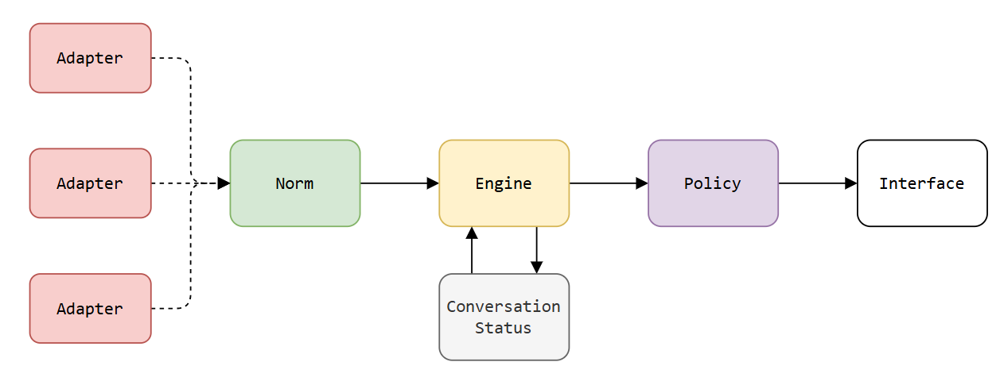

# mini-safeguard

SafeGuard is a research project for detecting scams in Vietnamese conversations as messages arrive. Partner applications send permitted messages and attachments. SafeGuard assesses the observed conversation and returns a warning action for the partner to display.

## Architecture



| Block | Responsibility |
|---|---|
| **Partner API and Ingress** | Admit scoped events and originals, enforce input limits, and preserve per-conversation order. |
| **Adapter** | Receive source events through Gateway and convert them through Norm. Preserve identity, provenance, and attachment references. |
| **Memory** | Keep scoped conversation state in Conversation Status and original bytes in Original Assets. The local backend uses SQLite and files. |
| **Detection** | Bind the observed prefix, run the Agent Controller with permitted tools and models, and commit an assessment with source references. |
| **Warning Policy** | Convert a committed assessment into a warning action and retain its own warning history. |

The owner's [Adapter drawing](docs/assets/architecture-adapter.png) and [Memory drawing](docs/assets/architecture-memory.png) show those blocks in detail. The [target architecture](docs/research/safeguard-target-architecture.html) is a research proposal for stateful, evidence-directed agent control.

## Current implementation

The local MVP has an agent loop, scoped reads, durable storage, warning delivery, and a messaging demo. Flash-Lite has returned an assessment and warning through the real demo API. Earlier Hydrogen functional checks covered text, tool feedback, output limits, and an authored PNG. Detector accuracy and the comparative value of new agent designs await an evaluation. Production authentication, partner delivery, and data-policy decisions remain open.

Only incoming demo messages start Detection. Outgoing text and files stay local and are withheld from the model and tools. The model may return `scam`, `no_scam_evidence`, or `insufficient_evidence`. Operational failures use a separate outcome. Tracing a verdict to the cited source establishes where the evidence came from. The semantic support of that evidence is measured separately.

## Development

The package requires Python 3.12 or later. The [Linux environment](pixi.toml) and [lockfile](pixi.lock) pin Python and the checked dependencies. From the repository root:

```sh
pixi install --locked
pixi run --as-is checks
```

The guarded suite runs component and handoff-schema checks with independently authored inputs. It blocks access to benchmark and seed data and saves results and source hashes under `.local/runs/checks/`.

Check the installed Google SDK with in-memory HTTP using a fresh output directory:

```sh
timeout 90s pixi run --as-is python -I -B tests/gemini_sdk_checks.py --output-dir .local/runs/checks/gemini-sdk-checks
```

To exercise offline agent execution and storage reopen with authored HTTP replies, use a fresh `--state-dir`:

```sh
mkdir -p .local/runtime
timeout 90s env PYTHONPATH=src .pixi/envs/default/bin/python -B -m safeguard.demo --state-dir .local/runtime/agent-demo
```

## Local partner messaging demo

Run an authored-reply demo without provider access:

```sh
mkdir -p .local/runtime
timeout 1800s env PYTHONPATH=src .pixi/envs/default/bin/python -B -m safeguard.partner_demo \
  --state-dir .local/runtime/partner-demo --port 8765
```

Open `http://127.0.0.1:8765/`. Choose a conversation and use **Send as** to switch roles. Enter sends a message. Shift+Enter adds a line. Choose the verification-code sample to see a warning and follow its source link.

**Clear messages** asks for confirmation before removing the selected conversation's local messages, attachments, analysis, and warnings. Other conversations and the Gemini usage ledger have separate lifecycles. Reuse the private state directory to retain history across restarts.

### Live messaging demo

Use the authorized nonbilled Gemini Developer API project and an owner-only key file. Use authored test data because incoming content and selected evidence can be sent to Gemini.

```sh
mkdir -p .local/runtime
timeout --signal=INT 3600s env PYTHONPATH=src .pixi/envs/default/bin/python -B -m safeguard.partner_demo \
  --state-dir .local/runtime/partner-demo-live --port 8766 --gemini-key-file .env.gemini-key
```

Open `http://127.0.0.1:8766/` and send a message as **Demo contact**. Live mode uses Gemini 3.1 Flash-Lite. The demo caps itself at 500 HTTP starts per Pacific quota day, five starts per rolling 61 seconds, and two model calls per message. The local daily counter tracks starts made through that demo store.

The demo accepts up to 10 MiB per attachment and previews valid PNG and JPEG files. Detection can present the newest eligible incoming PNG, JPEG, or PDF to Gemini. The UTF-8 tool reads up to 16 KiB of a selected original. Other originals remain available as references. [Demo entry point](src/safeguard/partner_demo.py) · [Live limits](src/safeguard/partner/live.py)

## Evaluation

The [benchmark catalog](evaluation/BENCHMARKS.md) lists the selected tasks, datasets, and interpretation limits. Corpus data stays separate from development tests. [Agent study](docs/research/agent-architecture.md) · [Agent evaluation protocol](docs/research/agent-evaluation.md)

## Documentation

| Need | Start here |
|---|---|
| Project rules | [AGENTS.md](AGENTS.md) |
| Product overview, setup, and demo | This README |
| Model and agent research | [Agent architecture study](docs/research/agent-architecture.md) |
| Benchmark selection and evidence | [Benchmark catalog](evaluation/BENCHMARKS.md) |
| Active scope in the owner checkout | Local `PLAN.md` |
| Verified status in the owner checkout | Local `STATUS.md` |
| Technical contracts in the owner checkout | Local `REFERENCE.md` |
| Workspace layout, local runs, runtime data, and archives | [Workspace layout](docs/workspace-layout.md) |

Application code is in [src/safeguard](src/safeguard/). The [partner package](src/safeguard/partner/) contains the partner service, demo stores, Gemini demo limits, and chat assets. Checks are in [tests](tests/), and documentation is in [docs](docs/).
