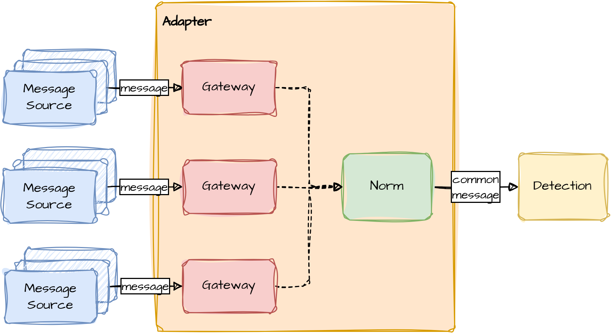
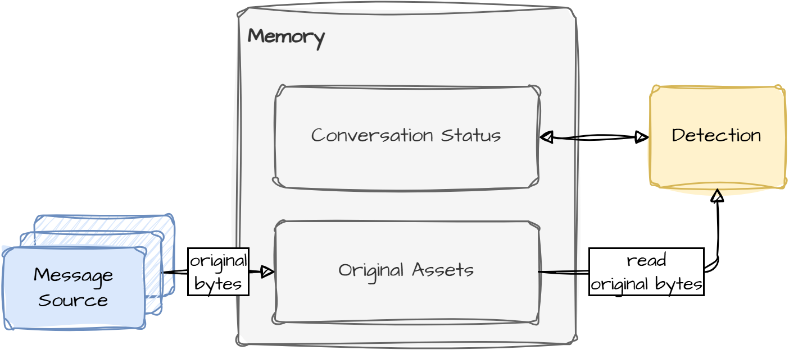

<div align="center">

# mini-safeguard


**Scam detection from conversation history, with interchangeable agent and workflow control.**

</div>

---

## Overview

mini-safeguard is a research project for detecting scams in Vietnamese conversations as messages
arrive. Each assessment uses the conversation observed through the current message. A separate
policy decides whether and when to warn the protected user.

The intended product is a service operated by the SafeGuard provider. Partner applications
supply permitted messages and attachments, then display returned warning actions.

The research compares agent and workflow control behind the same Detection boundary. Both
will use the same message, storage and capability contracts. Development starts with the agent;
the workflow will follow on a separate branch.

> **Note:** The current code implements input handling, storage and the Detection execution
> foundation. It does not yet run a scam-detection model or return warnings to an application.

---

## Architecture


Messages enter through Adapter, which produces a common message for Detection. Detection
reads conversation state and original attachments from Memory, then produces assessment signals.
Policy converts those signals into a warning action for the application.

These are logical responsibilities. Their boundaries do not require separate servers or processes.

### Adapter



Adapter contains two components:

- **Gateway** receives events in a source's native format and preserves source identity.
- **Norm** maps those events to the common internal message while retaining provenance.

The demo implementation handles individual messages and ordered streams. Common messages
contain ordered text, image, audio, video and file parts. Attachments travel as references;
their original bytes enter storage through the file-ingress path. Normalization does not decode
or interpret media.

The demo Adapter is complete for its agreed scope. Integration with real messaging sources
is deferred.

### Memory



Memory contains two independently accessible components:

- **Conversation Status** stores observed messages, derived evidence, analysis results and
  warning history in separate logical channels. Reads select an exact observed-history boundary;
  updates check scope, source references and state versions.
- **Original Assets** stores original attachment bytes with scoped identities, actual sizes
  and hashes. Detection reads originals through a checked interface. Derived text and model
  results remain separate from the originals.

Both stores belong on infrastructure operated by the SafeGuard provider. The current durable
backend uses SQLite and filesystem storage on the host running the service. "Local" describes
that host's storage; it does not require storage on a customer or end-user device. Temporary
file and in-memory backends are also available for development.

> **Note:** Messages, attachments and derived evidence can contain personal data. Current
> storage checks scope and filesystem permissions. Production authentication, staff access,
> encryption/key management, retention, deletion, backups and external-model data sharing
> still need a complete design. Functional storage checks do not establish production privacy readiness.

### Detection and Policy

Detection owns scam-risk assessment. Its current code provides intake, context preparation,
an Execution Host and scoped capability calls. The Host runs an injected controller, enforces
configured limits and validates result structure and source references.

The LLM call contract is designed. A real model client, agent controller and content readers
are not implemented. Reader and controller integration currently uses scripted test substitutes.

Policy will choose warning actions from assessment signals and permitted warning history.
Its implementation follows completion of Detection. The application return path is also future work.

---

## Current implementation

| Component | Implemented and checked | Remaining scope |
|---|---|---|
| Adapter | Demo Gateway/Norm, common messages, ordered stream handoff and provenance checks | Real-source integration is deferred |
| Ingress | Scoped admission, input limits, ordering within a conversation, bounded concurrency across conversations and explicit failure handling | Production authentication and transport/delivery policy |
| Memory | Scoped ports, temporary and durable backends, original-byte integrity, observed-history snapshots, versioned derived state and restart/recovery checks | Production privacy and storage operations; message edit/delete/replay policy |
| Detection | Intake, context preparation, scoped original reading, evidence contracts and Execution Host | Model client, real readers, agent controller and complete assessment flow |
| Policy and application return | Logical boundaries defined | Warning decisions, result delivery and warning display |

Integration tests connect real Adapter, ingress, storage and Host components using independently
authored messages/files and scripted readers/controllers. They cover scope isolation, exact history
boundaries, storage failures, stale updates and reopening durable stores.

The checked source passes **323 tests and 836 subcases**. The model-call design also passes
**88 offline authoring checks**. These checks establish the covered component behavior, not
scam-detection accuracy or real-model compatibility.

---

## Development

Python **3.12+** is required; the current checks use Python **3.14.4**. Runtime components use
the standard library. Tests additionally require **jsonschema 4.19.2**, declared in the
`test` extra in [pyproject.toml](pyproject.toml).

With those dependencies available in your project environment, run from the repository root:

```sh
timeout 90s env PYTHONPATH=src python3 -m unittest discover -s tests -p 'test_*.py' -v
```

The separate handoff-schema check uses newly authored toy envelopes:

```sh
timeout 90s python3 -I tests/contract_checks.py
```

The durable backend targets Linux/WSL. The timeout is an operational limit. Resource limits
are explicit configuration; test values are not production defaults.

To exercise the demo Adapter without a model or server:

```sh
PYTHONPATH=src python3 - <<'PY'
from safeguard.adapters.demo import create_demo_adapter

adapter = create_demo_adapter()
message = adapter.receive(
    {
        "thread": "library-room",
        "id": "opening-hours",
        "author": "librarian",
        "body": "The library opens at nine.",
    },
    account_id="reader",
    conversation_id="library-room",
)
print(message["content_parts"])
PY
```

---

## Evaluation

The [benchmark catalog](evaluation/BENCHMARKS.md) records selected tasks, dataset versions,
suitability audits and interpretation limits.

| Benchmark | Selected capability |
|---|---|
| ICFD-31k | Full-conversation and released-prefix classification |
| BABILong QA2/QA3 | Multi-fact question answering under distracting context |
| PhishRewrite | Classification robustness across fixed-source rewrite levels |
| SGC-250 | Reference-based first-warning timing and declared scam/benign pair checks, as an internal pilot |

Dataset/scoring audits are complete for the selected scope. A detector-evaluation runner and
rebuilt detector scores are not yet available. Raw benchmark inputs and private local benchmark
material are excluded from this repository's published files.

> **Note:** Keep benchmark examples out of development tests, debugging, fixtures and
> prompt/threshold tuning. Component checks use separately authored toy data.

---

## Project layout

| Path | Purpose |
|---|---|
| [`src/safeguard/adapters/`](src/safeguard/adapters/) | Gateway/Norm composition and common-message handoff |
| [`src/safeguard/ingress/`](src/safeguard/ingress/) | Admission, permissions context, limits and queue coordination |
| [`src/safeguard/memory/conversation_status/`](src/safeguard/memory/conversation_status/) | Observed history and derived-state storage |
| [`src/safeguard/memory/original_assets/`](src/safeguard/memory/original_assets/) | Scoped original-byte storage and retrieval |
| [`src/safeguard/scam_detection/`](src/safeguard/scam_detection/) | Detection intake, context, execution and evidence boundaries |
| [`src/safeguard/storage/`](src/safeguard/storage/) | Shared local SQLite/filesystem support |
| [`tests/`](tests/) | Component and integration tests with independent toy inputs |
| [`evaluation/`](evaluation/) | Benchmark catalog and dataset-audit evidence |
| [`docs/assets/`](docs/assets/) | Architecture drawings |
